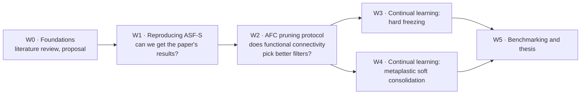

# NeuroPulse

**Structure-function-aware pruning for continual learning.** This is a final-year research project at the Department of Computer Science and Engineering, University of Moratuwa.

A neural network that learns tasks one after another usually forgets the earlier ones, a problem called *catastrophic forgetting*. One family of fixes gives every task its own small subnetwork inside a shared model, and protects that subnetwork while later tasks are learned. Those methods usually decide which weights a task keeps by their size. We are asking whether a better choice is to keep the weights that matter most for how the network *functions*. To measure that, we use the ideas behind Artificial Structure Function Search (ASF-S), a pruning method inspired by structure-function relationships in the brain.

📖 **Follow the work on our site: [neuropulse-co.github.io](https://neuropulse-co.github.io)**. Every study, result and decision is written up there in plain language, including the results that did not go the way we hoped.

## How the project fits together

| Workstream | Question | Where it stands (November 2026) |
|---|---|---|
| **W0** Foundations | What problem are we solving, and what do we propose? | Proposal submitted in August 2026. |
| **W1** Reproducing ASF-S | Can we reproduce the published pruning results? | Our from-scratch CIFAR-10 re-implementation matches the paper step by step. The final recovery step does not reproduce: retraining only the last layer loses 10.5 accuracy points, against the paper's 3.78. |
| **W2** AFC pruning protocol | Under a careful protocol, does preserving Artificial Functional Connectivity (AFC) select better filters than simple scores? | First comparison done. The corrected Principal Gradient Importance (PGI) beats random selection but not weight magnitude. Next is a go/no-go test. |
| **W3** Hard freezing | Can freezing each task's most important units let one network learn a sequence of tasks? | Starting. |
| **W4** Metaplastic consolidation | Can slowing learning on important weights replace freezing them? | Planned. |
| **W5** Benchmarking and thesis | How does our framework compare with PackNet, WSN and EWC? | Planned for February to March 2027. |

## Repositories

| Repository | What is in it |
|---|---|
| [ASF-S](https://github.com/NeuroPulse-Co/ASF-S) | Reproduction of ASF-S (W1) and the AFC pruning protocol (W2) |
| [ASF-S_Hard_Freezing](https://github.com/NeuroPulse-Co/ASF-S_Hard_Freezing) | Continual learning with hard freezing (W3) |
| [NeuroPulse-Co.github.io](https://github.com/NeuroPulse-Co/NeuroPulse-Co.github.io) | The project website |
| [research-template](https://github.com/NeuroPulse-Co/research-template) | The starting point for every new research repository |
| [.github](https://github.com/NeuroPulse-Co/.github) | Our [record standard](https://github.com/NeuroPulse-Co/.github/blob/main/standards/RECORDS.md), [writing guide](https://github.com/NeuroPulse-Co/.github/blob/main/standards/STYLE.md) and shared tools |

## How we work

Every experiment belongs to a *study* with a question, a hypothesis and a success criterion that we write down before running it. Every run records its code version, seed and environment. Every result says whether it comes from validation or test data. We publish negative results with the same care as positive ones. The details are in our [record standard](https://github.com/NeuroPulse-Co/.github/blob/main/standards/RECORDS.md).

## Team

**Students:** D.M.N.S. Gunarathna · W.B.S.S. Harinakshi · K.W.M.R.S.B. Wanigasooriya · S.W.G.M.Y.G.D.M. Wijekoon
**Supervisors:** Dr. Charith Chitraranjan (internal) · Prof. Varuna de Silva (external)
